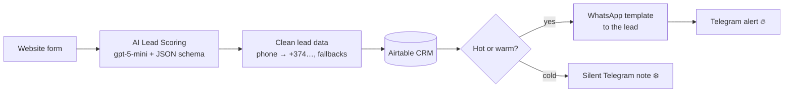

# AI Lead Qualifier — Speed-to-Lead for Real Estate

A website lead form that is **qualified by AI the moment it is submitted**: the lead gets a score (0–100) and a temperature (hot / warm / cold), is saved to an Airtable CRM, hot and warm leads instantly receive a WhatsApp message, and the manager gets a Telegram alert with a summary and the next step.

Built with **n8n**, **OpenAI** and the **WhatsApp Cloud API**. Demo company: "Demo Realty" (fictional agency, Yerevan · Dubai · Moscow).

🎬 **Demo video (Armenian):** [2-lead-processing-hy.mp4](https://czibuahmksmifbzapnkv.supabase.co/storage/v1/object/public/smm-images/videos/2-lead-processing-hy.mp4)
🧪 **Live demo form:** https://n8n-xwzd.srv2115236.hstgr.cloud/form/realty-lead-demo *(form texts are in Russian; it sends real Telegram alerts to me, please don't spam)*

---

## Problem

Agencies pay for ads, but leads from the website wait in an inbox until a manager has time. The first agency that calls back usually wins the client. Managers also spend time on "just looking" requests while serious buyers wait.

## Solution

One n8n workflow that answers and sorts every lead in seconds:

- AI reads the form and decides how serious the lead is, with a one-line summary and a concrete next step for the manager.
- Everything goes into a CRM table, even if the AI step fails.
- Hot and warm leads get a WhatsApp welcome immediately; cold leads are saved quietly for later.

## How it works



## Features

- Form with name, WhatsApp phone, email, city, budget, purpose, timeline, comment (bot submissions ignored)
- Structured AI output: `score`, `temperature`, `summary`, `next_step`, `interest`
- Clear scoring rules in the prompt (timeline + budget + purpose → hot; "just looking" or spam → cold)
- Phone normalization for Armenian numbers (`091…` / `91…` → `+37491…`)
- Lead is saved even if the AI fails (safe defaults + "check manually" note)
- Instant WhatsApp welcome to hot/warm leads; if sending fails, the manager is told to write by hand
- Telegram alerts with HTML escaping, so user input cannot break the message

## Tech stack

`n8n (Form Trigger)` · `OpenAI gpt-5-mini` · `Structured Output Parser` · `Airtable` · `WhatsApp Cloud API` · `Telegram Bot API`

## Repository structure

```
workflow/
  lead-qualifier.json
```

## Setup

1. Import `workflow/lead-qualifier.json` into n8n.
2. Select your own credentials on each node (they were removed from the export): *OpenAI*, *Airtable token*, *WhatsApp API*, *Telegram Bot*.
3. Create an Airtable table with fields:
   `Name`, `Phone`, `Email`, `City`, `Budget`, `Purpose`, `Timeline`, `Message`, `Score` (number), `Temperature`, `AI Summary`, `Next Step`, `Status`, `Created` (date-time).
4. Replace placeholders:

   | Placeholder | What it is |
   |---|---|
   | `YOUR_AIRTABLE_BASE_ID` | Airtable base id (`app…`) |
   | `YOUR_AIRTABLE_LEADS_TABLE_ID` | Airtable table id (`tbl…`) |
   | `YOUR_WHATSAPP_PHONE_NUMBER_ID` | Meta → WhatsApp → API Setup |
   | `YOUR_TELEGRAM_CHAT_ID` | Telegram chat that receives alerts |

5. In Meta, create a WhatsApp template `lead_welcome_ru` with 2 body variables (name, interest) — or change the template name in **Instant WhatsApp to Lead**. Until it is approved the node fails softly and the manager alert says "write manually".
6. Adjust the form fields and scoring rules for your business, then **Publish**. The form URL is shown on the Form Trigger node.

## Screenshots / video

- 🎬 Demo video: [watch](https://czibuahmksmifbzapnkv.supabase.co/storage/v1/object/public/smm-images/videos/2-lead-processing-hy.mp4)
- 🧪 Live form: [open](https://n8n-xwzd.srv2115236.hstgr.cloud/form/realty-lead-demo)
- n8n canvas screenshot: *coming soon*

## What I learned

- A structured output parser with a JSON example makes LLM output reliable enough to route on.
- Never let the AI step be a single point of failure: save the lead first-class, use defaults if the model returns nothing.
- Business-initiated WhatsApp messages need an approved template, and approval can take days — plan for a fallback.
- Escaping `<`, `>`, `&` matters when you put user input into Telegram HTML messages.

---

Made by **Sergo Abrahamyan** — AI Automation Engineer, Yerevan · [LinkedIn](https://www.linkedin.com/in/sergo-abrahamyan-2b6290432/) · [GitHub](https://github.com/sergo-abrahamyan-ai)
